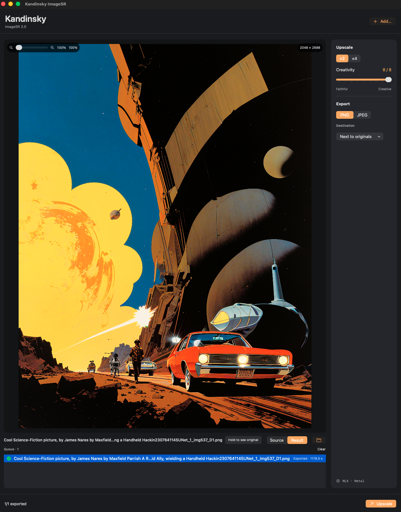

# Kandinsky ImageSR — enlarge a picture on your Mac

A small Mac app for [Kandinsky ImageSR 2.0](https://huggingface.co/kandinskylab/Kandinsky-ImageSR-2.0). Drop one picture or a folder onto the window, choose ×2 or ×4, and save the results.

The window is native Swift. The model runs locally on the Apple GPU using MLX and Metal. The finished app includes the model, so it can process pictures without an internet connection.

> This is an independent app built around Kandinsky Lab's model. It uses an MLX adaptation of the inference pipeline. See [Licence and attribution](#-licence-and-attribution).

---

## ✨ What it does

- **Drop pictures or folders** onto the window or app icon. You can also use **Add** or ⌘O. Folders are searched recursively. Newly added pictures stay in the queue, and the first new picture becomes selected.
- **Upscale one picture or a batch** by ×2 or ×4. The same settings apply to the batch. A progress indicator shows the current picture and tile.
- **Compare source and result.** Select either view, or hold **Hold to see original** and release it to return to the result.
- **Inspect the image.** Zoom with the mouse wheel or the slider. Drag the picture to move around it. The current image dimensions appear in the preview.
- **Save as PNG or JPEG** next to each original or in a chosen folder. Output names end in _KSR_x2 or _KSR_x4, with a number added if needed. Existing files are not overwritten.
- **Stop a batch** while keeping completed exports. An unreadable image is reported and the batch continues with the next one.

PNG, JPEG, HEIC/HEIF, AVIF, WebP, TIFF and BMP can be opened. PNG exports retain transparency. JPEG exports place transparent areas on white.

## ⚠️ Worth knowing before you start

This is a generative super-resolution model. Higher creativity can produce more invented detail. Level **4** uses Kandinsky's default setting for the selected scale. Compare the result with the original to choose the level you prefer.

Upscaling is not instant. Large images are processed as overlapping tiles, and ×4 generally needs many more tiles than ×2. The app loads the model once per batch and releases it when the batch finishes.

On the test Mac, a **380 × 214** input at ×2 took **9.8 seconds** on a warm run. A **1,024 × 1,024** input at ×2 took approximately **100 seconds**. Both measurements exclude model loading. The screenshot shows a **2,048 × 2,688** result that took about **19.6 minutes** to process. Time depends on image dimensions, scale and GPU load.

---

## 💻 Requirements

- A Mac with Apple Silicon and macOS 26 or later.
- Tested on an M4 Pro with a 20-core GPU and 64 GB of unified memory. Other Apple Silicon Macs have not been tested.
- The finished app occupies approximately **8.5 GB**. Building it needs at least **25 GB** free for the model download, intermediate files and the finished app.

## 📥 Get it

### Build from source

Install Xcode with its command-line tools, then run from this folder:

    ./scripts/build.sh

The script downloads a pinned standalone Python runtime and the official model, verifies their hashes, installs the required packages, prepares the MLX weights and builds the app in the build folder. Downloading the model requires an internet connection. The finished app runs locally.

The app is signed locally for the build and is not notarised with an Apple Developer ID. A distributable release has not yet been prepared.

---

## 🎛️ The controls

| Control | What it does |
| --- | --- |
| **×2 / ×4** | Multiplies the width and height of the output. |
| **Creativity 0–8** | Adjusts the model's reconstruction. Level 4 is the official default. |
| **PNG / JPEG** | Chooses the output format. PNG supports transparency. |
| **Destination** | Saves next to each original or in a chosen folder. |
| **Zoom and drag** | Inspects either view without changing the exported image. |
| **Hold to see original** | Shows the source while held. Releasing it returns to the selected view. |
| **Stop** | Stops the current batch and keeps exports already completed. |

## 🔬 How it runs on Apple Silicon

The upstream model uses 1,024-pixel output tiles with overlapping edges. This app implements its inference in MLX. The transformer uses FP16 visual weights and FP32 modulation. The VAE runs in BF16. Timestep projections are precalculated for the model's supported creativity settings.

On the 380 × 214 test image at ×2, the upstream PyTorch MPS pipeline took 12.8 seconds on a warm run. The MLX mixed-precision version took 9.8 seconds. The mean absolute difference between their outputs was 1.24 levels per channel on a 0–255 scale. These measurements describe one image on one M4 Pro.

## 🧾 Limits

- Output is **8-bit sRGB**. Embedded ICC profiles and EXIF orientation are applied when reading.
- Transparency is enlarged separately and restored for PNG. JPEG has no alpha channel and uses a white background.
- The output does not retain the original EXIF or XMP metadata.
- The preview uses a thumbnail up to 4,096 pixels on its longest edge. The model processes the full input.
- The 8.5 GB app is built for Apple Silicon and macOS 26 or later. Memory and performance on other configurations have not been measured.

---

## 📜 Licence and attribution

The app source is offered under the MIT licence. See [LICENSE](LICENSE) and [NOTICE.txt](NOTICE.txt).

The original [Kandinsky ImageSR pipeline](https://github.com/kandinskylab/kandinsky-image-sr) and transformer are released by Kandinsky Lab under MIT. The bundled VAE comes from [FLUX.1-schnell](https://huggingface.co/black-forest-labs/FLUX.1-schnell) under Apache 2.0. The MLX engine adapts the original calculations and converts the transformer's visual weights to FP16. Third-party licence texts are in [licenses](licenses/).

## 🙏 Thanks

To Kandinsky Lab for releasing ImageSR 2.0 and its inference code, and to the MLX team for its Apple Silicon framework.
